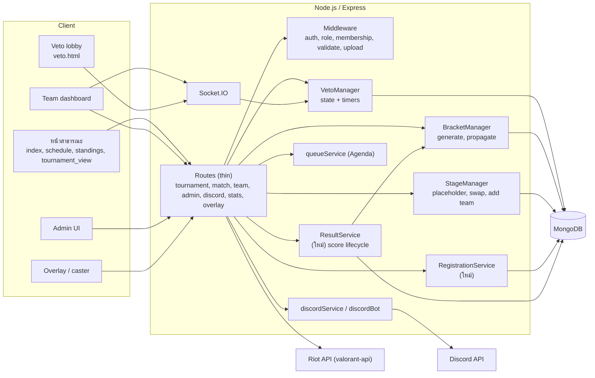
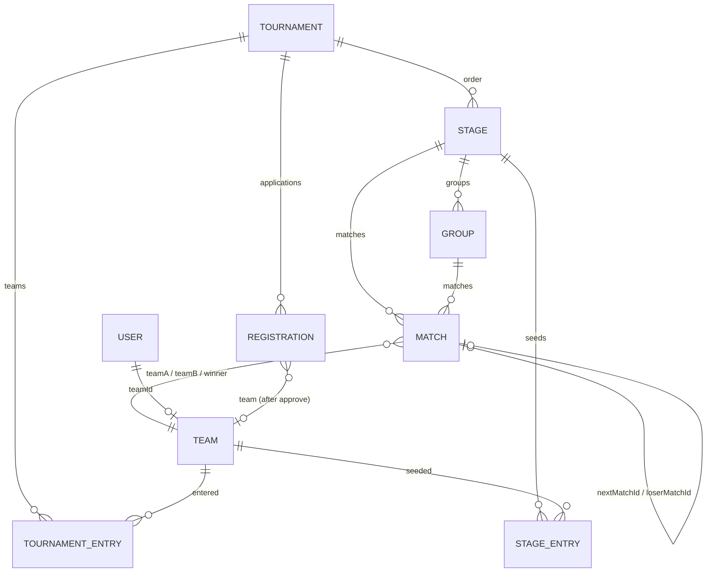
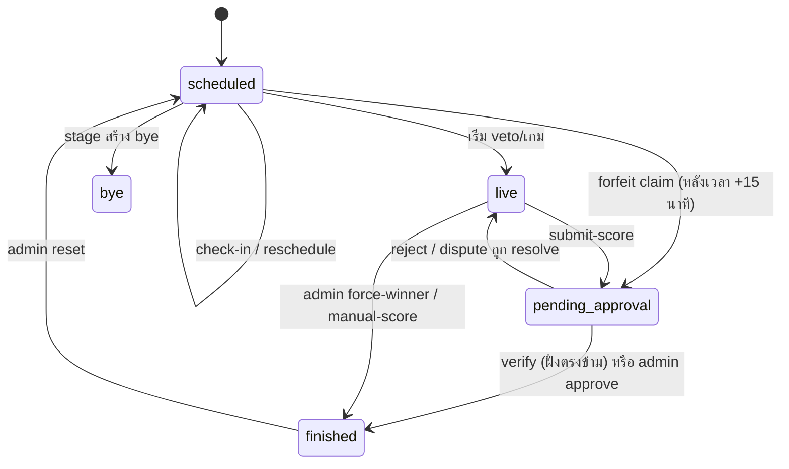
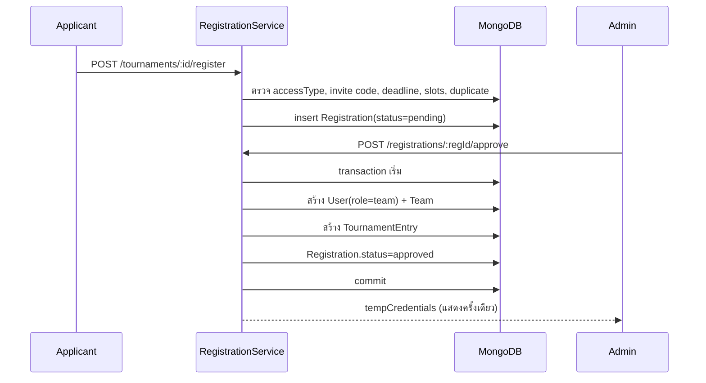

# VALORANT Tournament Platform: System Design v2

Repository: `NOOMFUU/valorant-tournament`
Code baseline: branch `fix/security-and-consistency` (commit `cbd0e1a`)
Feature PR in progress: #1 (`chore/remove-room-password`, draft)

v2 เขียนจากการอ่านโค้ดจริงใน repo และแก้ข้อผิดพลาดของ v1 ดังนี้
- v1 บอกว่า `verify-score` ไม่มี route: จริงๆ อยู่ใน `routes/tournamentRoutes.js` (บรรทัด `POST /matches/:id/verify-score`)
- v1 บอกว่า relational model ยังไม่เริ่ม: จริงๆ มี model `Stage`, `StageEntry`, `Group`, `TournamentEntry`, `Registration` และ `managers/bracketManager.js` ใช้แล้ว แต่ routes ส่วนใหญ่ยังเรียกโครงสร้างเก่า ทำให้ระบบไม่สอดคล้องกัน
- ส่วนที่ยังไม่ได้อ่านโค้ดจริงถูกระบุไว้ในข้อ 17.6

---

## 1. เป้าหมายและหลักการ

ระบบจัดทัวร์นาเมนต์ VALORANT แบบทีม 5v5 ครอบคลุม:
1. เปิดรับสมัครทีม (open / invite_only / private) และ admin อนุมัติ
2. สร้าง stage และ match (round robin, swiss, single/double elimination)
3. นัดเวลา, check-in, veto แผนที่แบบ real-time
4. รายงานผล, ยืนยันจากอีกฝ่าย, dispute, admin ตัดสิน
5. ประกาศผลและจัดการช่อง Discord ของแมตช์

หลักการออกแบบ
1. **Single source of truth**: ข้อมูลทัวร์นาเมนต์อยู่ใน collection แบบ relational (`Stage`, `StageEntry`, `Group`, `TournamentEntry`, `Registration`) ห้ามมี embedded array ซ้ำซ้อน
2. **Server-side authority**: การ verify สิทธิ์ (ว่าเป็นทีมในแมตช์หรือไม่) และการคำนวณผลทำที่ server เสมอ
3. **Manager เป็นจุดเดียวที่แก้ state**: routes เป็น thin controller เรียก manager/service เท่านั้น
4. **Discord เป็น convenience layer**: ถ้า Discord ล่ม ทัวร์นาเมนต์ต้องทำงานต่อได้
5. **Auditable**: ทุก action สำคัญลง `AdminLog` และ Winston พร้อม `matchId`, `teamId`, `actorId`

Non-goals (ตอนนี้): multi-instance, payment, ranking ข้ามฤดูกาล

---

## 2. สถาปัตยกรรม

**จุดที่ต้องเพิ่มจาก v1**
- `RegistrationService`: รวม logic สมัคร/อนุมัติ/ปฏิเสธ (ปัจจุบันอยู่ใน route)
- `ResultService`: รวม submit, verify, dispute, approve, reject, force-winner, manual-score ให้อยู่ที่เดียว (ปัจจุบันกระจายใน `matchRoutes.js` และ `tournamentRoutes.js` และแต่ละที่ทำซ้ำกัน)
- Membership middleware: ตรวจว่า `req.user.id` เป็น `teamA` หรือ `teamB` ของแมตช์ก่อนทุก action ของทีม

---

## 3. Actors และสิทธิ์

| Actor | Auth | สิทธิ์ |
|---|---|---|
| Public | ไม่ต้อง login | ดู tournament, bracket, match, standings, schedule (ไม่มีข้อมูลส่วนตัว) |
| Applicant | ไม่ต้อง login | ส่ง registration (ต้องมี invite code ถ้า `invite_only`) |
| Team member | JWT `role=team` + Team `status=approved` | จัดการ roster ตัวเอง, check-in/veto/report เฉพาะแมตช์ของตัวเอง |
| Team captain | ยังไม่แยก role | **ต้องเพิ่ม** field `isCaptain` ใน member |
| Admin | JWT `role=admin` | จัดการทุกอย่าง, อนุมัติผล, override |
| Discord bot | Discord token | สร้าง/ลบ channel, role, embed |

ปัญหา: `middleware/auth.js` เช็คแค่ role และ team status ไม่เช็คว่า team เป็นเจ้าของแมตช์

---

## 4. Data Model (เป้าหมาย)

### 4.1 Tournament
- ฟิลด์: `name`, `status`, `accessType`, `inviteCode`, `mapPool`, `registration{}`, `prizePool`, `rules`, `isArchived`
- **ลบ**: `participants`, `pendingRegistrations`, `stages[]` (embedded) ออกจาก schema แล้ว (ตอนนี้เป็น virtual)
- **เพิ่ม**: `currentStageId` (ใช้ตอน stage ถัดไปเริ่ม)

### 4.2 Stage / Group / StageEntry / TournamentEntry
- `Stage`: `order`, `name`, `type`, `settings`, `sourceStage`, `status` (มีอยู่แล้ว)
- `Group`: มีอยู่ (ต้องเพิ่ม `stage`, `order`, `name` ตรวจ schema จริงก่อนใช้)
- `StageEntry`: `stage`, `team`, `group`, `seed`, `status`, `finalRank` (มีอยู่)
- `TournamentEntry`: `tournament`, `team`, `registration`, `status` (มีอยู่ แต่ **ยังไม่มี code สร้าง** เมื่อ approve)
- **กฎ**: ทีมที่อยู่ใน `TournamentEntry` คือทีมที่เข้าแข่งทัวร์นาเมนต์ ใช้เป็นฐานของ stage ทั้งหมด

### 4.3 Registration
- Schema จริง: `teamName`, `contact`, `members[]{name, riotId, puuid, role}`, `status`, `rejectionReason`, `reviewedBy`, `reviewedAt`
- **ปัญหา**: route `POST /tournaments/:id/register` เขียนลง `Tournament.pendingRegistrations` (ไม่มีใน schema แล้ว) และใช้ field `contactName`, `contactDiscord` ที่ไม่มีใน schema
- **เป้าหมาย**: เขียนลง `Registration` collection เท่านั้น และเก็บ `contactDiscord` เพิ่ม

### 4.4 Team
- Schema จริง: `username` (unique, lowercase), `name`, `shortName`, `password`, `logo`, `status`, `discordRoleId`, `members[]`, `rosterLocked`, `wins`, `losses`
- **ปัญหา 1**: `MemberSchema` ไม่มี `riotId`, `puuid` ใน `Registration` ถูกส่งต่อแล้วจะหาย (approve ไม่ได้ map field นี้) ต้องเพิ่ม `riotId`
- **ปัญหา 2**: `Team.password` และ `User.password` มีคู่กัน ควรเลือกที่เดียวเป็นแหล่งจริง (แนะนำ `User` เป็น auth, `Team` ไม่เก็บ password)
- **เป้าหมาย member**: `riotId`, `puuid`, `discordId`, `isCaptain`, `status`, `pendingUpdate{riotId}`

### 4.5 Match
- Schema มี `stage`, `group`, `teamA/B`, `teamARoster/BRoster`, `scores[]`, `scoreSubmission{}`, `checkIn{}`, `rescheduleRequest{}`, `pauseRequest{}`, `vetoData{}`, `discordChannelId`
- **ลบ**: `roomPassword` (ยังอยู่ใน base, PR #1 กำลังลบ) ต้องคง `roomName` ไว้
- **เพิ่ม**: `resultVersion` (optimistic concurrency), `forfeit{ isForfeit, claimedBy }` แทนการใช้ `rejectReason === 'FORFEIT CLAIM'` และ `name += " (Forfeit)"`
- `status` enum: `scheduled`, `live`, `pending_approval`, `finished`, `bye`, `auto_forfeit`

---

## 5. Match Lifecycle

**กฎที่ต้องบังคับใน ResultService**
- `submit-score` ได้เฉพาะ status `live` หรือ `scheduled` ที่ veto เสร็จแล้ว และผู้ส่งต้องเป็นทีมในแมตช์
- `verify-score` ได้เฉพาะ **ทีมตรงข้าม** ของ `scoreSubmission.submittedBy` (ปัจจุบันไม่มีการเช็ค)
- `dispute` ต้องเป็นทีมตรงข้ามเช่นกัน
- การเปลี่ยนผลที่ `finished` แก้ได้เฉพาะ admin และต้องลง AdminLog พร้อมค่าเดิม
- Reset ต้องล้าง `scores`, `winner`, `vetoData`, `checkIn`, `scoreSubmission`, และ **ย้อนค่า `wins`/`losses` และ bracket ที่ propagate ไปแล้ว** (ปัจจุบันไม่ทำ)

---

## 6. Registration Flow (แก้ใหม่)

**ข้อกำหนด**
- Approve ต้องอยู่ใน transaction เพราะปัจจุบันถ้า `t.participants.push` ล้มเหลว จะเหลือ User และ Team ที่ไม่มีที่มา
- Temp password ไม่ควรเก็บ plaintext หรือ log ซ้ำ ให้ส่งผ่านช่องทางที่ admin ยืนยันเอง และบังคับเปลี่ยนรหัสตอน login ครั้งแรก
- การ `register` ต้องใช้ `Registration` collection และ rate limit ต่อ IP (`express-rate-limit` มี import แต่ยังไม่พบการใช้งานในส่วนที่อ่าน)

---

## 7. Stage และ Bracket

**สิ่งที่ต้องแก้ให้ตรงกับ schema ใหม่** (รายการจากการอ่าน `routes/tournamentRoutes.js` และ `managers/`)

| จุดที่เรียก | ปัญหา | แนวทางแก้ |
|---|---|---|
| `POST /tournaments/:id/stages/generate` | `tournament.stages.push(...)` ทำกับ virtual ไม่ได้ และ `BracketManager.generateStage(tid, name, type, participants, settings)` ไม่ตรงกับ signature `(tournamentId, stage, teams)` | สร้าง `Stage` document ก่อน แล้วส่ง `stage` เข้า manager |
| `stages/:stageIndex/*` | ใช้ index ของ array ทั้งหมด แต่ model ใช้ `Stage._id` | เปลี่ยนเป็น `/stages/:stageId/*` |
| `BracketManager.getStageStandings(tid, index)` | signature รับ `stageId` เท่านั้น | ใช้ `stageId` |
| `BracketManager.resolveStagePlaceholders`, `addTeamToStage`, `swapTeamsInStage` | อยู่ใน `stageManager.js` ไม่ได้ export จาก `bracketManager` (เรียกแล้วจะ TypeError) | เรียกผ่าน `StageManager` |
| `BracketManager.generateNextSwissRound(id, stageIndex)` | รับ `(stageId, roundNumber)` แต่ route ไม่ส่ง `roundNumber` | คำนวณ round จาก match ล่าสุดใน stage |
| `BracketManager.updateMatch(match)` ใน verify-score | signature คือ `(matchId, {winnerId, scores})` | ย้ายเข้า `ResultService` |
| `Tournament.updateMany({"stages.matches": id})` ใน DELETE match | field นี้ไม่มีแล้ว | ลบ `match.stage` ออกเมื่อ match ถูกลบ |
| `GET /tournaments/:id/public` populate `stages.matches` | virtual `stages` ไม่มี path `matches` | populate `Stage` แล้ว populate `Match` ผ่าน stage |
| `DELETE /tournaments/:id/stages/:stageIndex` | splice array และลบ match ด้วย `stage.matches` | ลบ `Stage`, `Group`, `StageEntry`, `Match` ที่ `stage` ตรงกัน ใน transaction |

**Format ที่รองรับ**
- รองรับแล้วใน `BracketManager`: round_robin (พร้อม group และ legs), swiss, single_elim, double_elim (ไม่มี split)
- ยังไม่รองรับ (throw "Phase 3"): `gsl`, `cross_group`, `triple_elim`, multi-group elimination, split double elim
- Bracket เลือก winner/loser ผ่าน `nextMatchId`/`loserMatchId` เท่านั้น ไม่มี BYE-drop flag แบบเดิม

**Tie-break** (`getStageStandings`): ค่าเริ่มต้น `h2h → map_diff → round_diff` ถ้า tie ทั้งหมดจะคืน 0 (ไม่ deterministic) ต้องเพิ่ม seed เป็นตัวตัดสินสุดท้าย

---

## 8. Result Lifecycle (ResultService ใหม่)

รวมโค้ดที่ซ้ำกันอยู่ใน `matchRoutes.js` และ `tournamentRoutes.js` ไว้ที่เดียว

| Operation | Actor | Preconditions | ผลลัพธ์ |
|---|---|---|---|
| `submitScore` | Team (ในแมตช์) | status live, ยังไม่มี pending | `pending_approval`, `scoreSubmission` |
| `verifyScore` | Team (ฝั่งตรงข้าม) | status pending_approval, submittedBy ≠ ผู้ verify | `finished`, propagate |
| `disputeScore` | Team (ฝั่งตรงข้าม) | pending_approval | `isDisputed=true`, แจ้ง admin |
| `approveScore` | Admin | pending_approval | `finished`, propagate, log |
| `rejectScore` | Admin | pending_approval | `live`, ล้าง tempScores |
| `editPendingScore` | Admin | pending_approval | แก้ tempScores, log |
| `forceWinner` | Admin | ไม่ finished | `finished`, propagate, log |
| `manualScore` | Admin | - | `finished` ถ้า map ครบ, log |
| `claimForfeit` | Team (ในแมตช์) | หลัง +15 นาที, มี proof | `pending_approval` พร้อม forfeit flag |

**กฎที่ต้องแก้**
- **Tie**: `approve-score` และ `verify-score` ใช้ `wA > wB ? A : B` ทำให้เสมอ = teamB ชนะ ต้องบังคับให้ผลต้องชนะ map ครบตาม format (BO1 = 1, BO3 = 2, BO5 = 3) มิฉะนั้น reject
- **Idempotency**: `propagateMatchResult` ต้องเรียกได้ซ้ำโดยไม่ทำให้ `wins`/`losses` เพิ่มซ้ำ (ใช้ `resultVersion` หรือ check `status` ก่อนเพิ่ม)
- **Concurrency**: ใช้ `findOneAndUpdate` พร้อมเงื่อนไข `status: 'pending_approval'` เพื่อกันการ verify พร้อมกันสองครั้ง
- **Audit**: ทุก operation ลง `AdminLog` (ปัจจุบัน `verify-score` ฝั่งทีมไม่ลง log) และ Winston
- **Forfeit naming**: ใช้ flag `forfeit.isForfeit` แทนการต่อท้าย `name`

---

## 9. Check-in, Reschedule, Pause

| กระบวนการ | กฎปัจจุบันใน server | ปัญหา | เป้าหมาย |
|---|---|---|---|
| Check-in | เปิดก่อน 30 นาที, ปิดหลัง 15 นาที, มี `windowOpen` ให้ admin override | dashboard แสดงปุ่มถึง -10 นาที (ไม่ตรงกัน) | config เดียว: `CHECKIN_OPEN_BEFORE_MIN`, `CHECKIN_CLOSE_AFTER_MIN` ส่งให้ client ผ่าน API |
| Reschedule | ทีมใดก็ได้ขอ, อีกฝ่ายตอบ, accept reset check-in และ reschedule job | ไม่ตรวจว่า `proposedTime` อยู่ในอนาคต | validate เวลา และจำกัดจำนวนครั้งต่อแมตช์ |
| Pause (veto) | ทีมขอผ่าน `vetoMgr.handleTeamPause`, จำกัดจำนวนครั้ง | - | คงเดิม |
| Pause (นอก veto) | บันทึก `pauseRequest` แบบ pending | ไม่มี timer หรือ resume ที่ชัดเจน | กำหนด state ใน Match lifecycle |

**Socket.IO CORS**: ใน `server.js` ตั้ง `origin: "*"` ต้องจำกัดเป็นโดเมนจริง

---

## 10. Veto System (`managers/vetoManager.js`)

- Flow เดิม (ban/pick/side, priority, timer 45 วินาที, pause limit, coin toss)
- **ต้องแก้**: `areIdsEqual()` ถูกเรียกใน `handlePriorityReport` และ `startCoinToss` แต่ไม่ได้ประกาศหรือ import (ReferenceError)
- **ต้องแก้**: `restoreTimers()` ต้องถูกเรียกหลัง DB connect จริง ไม่ใช่แค่ตอน boot
- **ต้องเพิ่ม**: ตรวจ membership ใน socket `join_match` (ปัจจุบันรับ `teamId` จาก client โดยตรง)
- **ต้องเพิ่ม**: auto-action เมื่อหมดเวลา (ยังไม่ยืนยันพฤติกรรมในโค้ด)
- **ต้องเพิ่ม**: persist veto state ลง `Match.vetoData` ทุก action (state ต้องกู้ได้หลัง restart)
- `veto.html` ยังมี `setRoomPass()` และ `#roomPassContent` ซึ่ง PR #1 ยังไม่ได้แก้

---

## 11. Discord Integration

**Resource mapping**
- Team = role (`Team.discordRoleId`)
- Match = category + text channel + voice channel 2 ห้อง (ปิดห้องคู่ต่อสู้)
- Spectator role (optional)
- Verify channel + ปุ่ม `claim_role`

**ปัญหาที่พบ**
- ชื่อ env ไม่ตรงกัน: `DISCORD_ADMIN_LOGS_CHANNEL_ID` กับ `DISCORD_ADMIN_LOG_CHANNEL_ID`
- `setupDiscordChannels` เขียนค่าลง `process.env` ตอนรัน หายเมื่อ restart ต้อง persist ลง DB (เช่น collection `DiscordConfig`)
- `Team.discordRoleId` และ channel id ต้องมี reconcile job เมื่อ Discord และ DB ไม่ตรงกัน
- ใน `routes/matchRoutes.js` หลาย endpoint เรียก `discordClient.channels.fetch(...)` โดยตรง ถ้า bot offline จะ throw (ต้องใช้ `discordService` เป็นตัวกลางแบบ no-op เมื่อ disabled)

**Graceful degradation**: ทุก call ไป Discord ต้องอยู่หลัง try/catch และส่ง event เข้า queue เพื่อ retry

---

## 12. Real-time (Socket.IO)

- Rooms: `team:{teamId}`, `match:{matchId}`, `admins`, `tournament:{id}`
- ปัจจุบัน `io.emit('match_update', match)` ส่งทุกคนและส่ง object เต็ม รวมถึง `vetoData` และ `scoreSubmission` ต้องแก้ให้ส่งเฉพาะ public fields ตาม role
- `bracket_update` ส่ง payload ไม่สม่ำเสมอ (บางที่ไม่มี payload) ควรกำหนด schema: `{ tournamentId, stageId, reason }`
- `system_stats` ส่งทุก 3 วินาทีให้ทุกคน ควรส่งเฉพาะ `admins`
- `notification` ใช้ `io.to(teamId)` แต่ client ต้อง join room นั้นเอง ต้องตรวจว่า server ทำ join ให้เฉพาะ user ที่ auth แล้ว

---

## 13. Security

| หัวข้อ | สถานะ | ต้องทำ |
|---|---|---|
| Membership check ทุก route ของทีม | **ไม่มี** (`submit-score`, `verify-score`, `dispute-score`, `claim-forfeit` ไม่เช็คว่า user อยู่ในแมตช์) | middleware `requireMatchMember` |
| Verify โดยทีมเดียวกับ submitter | **ไม่มี** | บังคับ `submittedBy !== requester` |
| Public response รั่วข้อมูล | บางส่วนแก้แล้ว (`SAFE_TEAM_FIELDS`) แต่ `GET /matches` และ `GET /matches/:id` ยังส่ง `vetoData`, `scoreSubmission` ทั้งหมด | ใช้ serializer ตาม role |
| roomPassword | ยังอยู่ใน base, PR #1 กำลังลบ | merge PR #1 และรัน migration |
| Helmet CSP | ปิด | เปิดพร้อม allowlist |
| CORS Socket.IO | `*` | จำกัดโดเมน |
| JWT ฝั่ง client | localStorage | พิจารณา httpOnly cookie |
| Rate limit | import แต่ไม่พบการใช้ | login, register, upload |
| Upload | ตรวจชนิดและขนาดฝั่ง client | ตรวจ MIME และ magic bytes ฝั่ง server (`middleware/upload.js` ยังไม่อ่าน) |
| Team auth | JWT role team ไม่เช็ค DB ว่าเป็น team ที่ยัง active | คงเดิม แต่เช็ค membership ต่อแมตช์ |
| Admin | ยัง seed จาก `ADMIN_PASSWORD` | คงเดิม |
| Temp password | แสดงใน response | ดูข้อ 6 |

---

## 14. Non-functional

- **Scalability**: single instance เพราะ `VetoManager` และ presence อยู่ในหน่วยความจำ ถ้าต้อง scale ต้องใช้ Redis adapter และย้าย state ไป Redis (`utils/redis.js` มีอยู่ ยังไม่ได้อ่านว่าใช้ทำอะไร)
- **Consistency**: การ approve registration, propagate bracket, และอัปเดต wins/losses ต้องอยู่ใน transaction (MongoDB session) หรือ idempotent
- **Observability**: Winston logger และ `logAdminAction` มีอยู่ เพิ่ม request id
- **Error contract**: ใช้รูปแบบ `{ success, msg }` ทุก route (ตอนนี้บาง route ส่ง `{ msg }` บาง route ส่ง `{ success, msg }`)
- **Testing**: มี `tests/bracketManager.test.js`, `stageManager.test.js`, `vetoManager.test.js` ยังไม่ได้รันและไม่ได้อ่านเนื้อหา ต้องเพิ่ม test สำหรับ ResultService, RegistrationService และ membership middleware

---

## 15. Migration และ Roadmap

| Phase | งาน | ไฟล์หลัก | สถานะ |
|---|---|---|---|
| 1 | Merge PR #1 (ลบ roomPassword ใน backend) และรัน migration `unset-room-password.js` | routes, models, scripts | Draft |
| 1b | แก้ `areIdsEqual` ใน vetoManager | `managers/vetoManager.js` | ยังไม่เริ่ม |
| 1c | แก้ `veto.html` (`setRoomPass`, `#roomPassContent`) | `public/veto.html` | ยังไม่เริ่ม |
| 2 | ย้าย tournament routes ทั้งหมดไปใช้ `Stage._id` และ `Registration`, ลบ `stages`/`pendingRegistrations`/`participants` เก่า | `routes/tournamentRoutes.js`, `models/Tournament.js` | ยังไม่เริ่ม (สำคัญสุด) |
| 2b | เพิ่ม `TournamentEntry` ตอน approve และใช้เป็นฐานของ stage | `RegistrationService` ใหม่ | ยังไม่เริ่ม |
| 2c | แก้ signature mismatch ทั้งหมดในข้อ 7 | `routes`, `managers` | ยังไม่เริ่ม |
| 3 | สร้าง `ResultService` และรวม logic score ทั้งหมด พร้อม membership middleware | `routes/matchRoutes.js`, `routes/tournamentRoutes.js` | ยังไม่เริ่ม |
| 4 | Transaction สำหรับ approve registration และ reset/propagate | managers, services | ยังไม่เริ่ม |
| 5 | Socket hardening: rooms, payload ตาม role, CORS | `server.js`, `vetoManager.js` | ยังไม่เริ่ม |
| 6 | Discord: config persist, reconcile, graceful no-op | `services/discordService.js` | ยังไม่เริ่ม |
| 7 | Phase 3 formats: gsl, cross_group, triple_elim, multi-group elim | `managers/bracketManager.js` | ยังไม่เริ่ม |

**ลำดับที่แนะนำ**: 1 -> 1b -> 2 -> 2c -> 3 -> 2b -> 4 -> 5 -> 6 -> 7 (Phase 2 ต้องมาก่อน Phase 3 เพราะ stage routes ตอนนี้จะ crash)

---

## 16. Known Issues (จากโค้ดที่อ่าน)

| # | ปัญหา | ความรุนแรง | ที่อยู่ |
|---|---|---|---|
| 1 | Register และ approve เรียก `pendingRegistrations`/`participants` ที่ไม่มีใน schema แล้ว จะ TypeError | สูงมาก | `tournamentRoutes.js` |
| 2 | Stage routes ใช้ `stageIndex` และ `tournament.stages.push` กับ virtual | สูงมาก | `tournamentRoutes.js` |
| 3 | Signature mismatch: `generateStage`, `getStageStandings`, `updateMatch`, `generateNextSwissRound` | สูง | `tournamentRoutes.js`, `bracketManager.js` |
| 4 | `BracketManager.resolveStagePlaceholders`/`addTeamToStage`/`swapTeamsInStage` ไม่มี ย้ายไป StageManager | สูง | `tournamentRoutes.js` |
| 5 | Submit/verify/dispute/forfeit ไม่เช็ค membership และ verify ไม่บังคับฝั่งตรงข้าม | สูง (integrity) | `matchRoutes.js`, `tournamentRoutes.js` |
| 6 | `areIdsEqual` ไม่ได้ประกาศ | สูง | `vetoManager.js` |
| 7 | Registration approve ไม่อยู่ใน transaction | สูง | `tournamentRoutes.js` |
| 8 | Team MemberSchema ไม่มี `riotId`/`puuid` ข้อมูลหายตอน approve | กลาง | `models/Team.js` |
| 9 | Team และ User เก็บ password คู่กัน | กลาง | `models/Team.js`, `models/User.js` |
| 10 | Tie ใน approve/verify ให้ teamB ชนะ | กลาง | `matchRoutes.js`, `tournamentRoutes.js` |
| 11 | Reset ไม่ย้อน wins/losses/bracket | กลาง | `matchRoutes.js` |
| 12 | `DELETE match` ใช้ `stages.matches` ที่ไม่มีแล้ว | กลาง | `matchRoutes.js` |
| 13 | Check-in window ไม่ตรงระหว่าง server (30/15) และ dashboard (-10) | กลาง | `matchRoutes.js`, `team-dashboard.html` |
| 14 | Admin log env name ไม่ตรงกัน | ต่ำ | `services/discordService.js` |
| 15 | Socket CORS `*` | กลาง | `server.js` |
| 16 | Socket payload ส่ง object เต็มและไม่แยกตาม role | กลาง | `matchRoutes.js`, `server.js` |
| 17 | Discord channel id หายตอน restart | กลาง | `services/discordService.js` |
| 18 | Tie-break standings ไม่มี seed เป็นตัวสุดท้าย | ต่ำ | `bracketManager.js` |
| 19 | `veto.html` ยังมี room password helper | ต่ำ | `public/veto.html` |
| 20 | Forfeit ต่อท้าย `name` ทุกครั้งที่ approve ซ้ำ | ต่ำ | `matchRoutes.js` |

---

## 17. ฟังก์ชันที่ต้องมีให้ครบ (Function Catalog)

สถานะ: **มี** = ใช้งานได้ตามที่อ่าน, **พัง** = เรียกแล้วจะ error, **ขาด** = ยังไม่มี

### 17.1 Tournament
| Function | Route | สถานะ |
|---|---|---|
| สร้าง/แก้/archive/delete tournament | `/tournaments` | มี (delete ยังใช้ `stages.matches`) |
| ดู public tournament | `/tournaments/:id/public` | พัง (populate `stages.matches`) |
| จัดการ access type และ invite code | `/tournaments/:id/access` | มี |
| ตั้งค่า registration | `/tournaments/:id/registration` | มี |

### 17.2 Registration
| Function | Route | สถานะ |
|---|---|---|
| ดู access info | `/tournaments/:id/access` | มี |
| สมัคร | `/tournaments/:id/register` | พัง (`pendingRegistrations`) |
| รายการสมัคร | `/tournaments/:id/registrations` | พัง |
| อนุมัติ | `/registrations/:regId/approve` | พัง (`participants`) และไม่ transaction |
| ปฏิเสธ | `/registrations/:regId/reject` | พัง |

### 17.3 Stage และ Bracket
| Function | Route | สถานะ |
|---|---|---|
| สร้าง stage | `/stages/generate` | พัง (ข้อ 7) |
| resolve placeholder | `/stages/:i/resolve` | พัง (ข้อ 16 #4) |
| เพิ่ม match เอง | `/stages/:i/matches` | พัง (`tournament.stages[i].matches.push`) |
| swiss round ถัดไป | `/stages/:i/swiss-next` | พัง (ข้อ 16 #3) |
| standings | `/stages/:i/standings` | พัง (signature) |
| เพิ่ม/สลับทีมใน stage | `/stages/:i/teams/*` | พัง (ข้อ 16 #4) |
| ลบ stage | `DELETE /stages/:i` | พัง (ใช้ index และ `stage.matches`) |
| แก้ placeholder | `/matches/:id/placeholder` | ขาด code ที่ใช้ `sourceStage` ใหม่ (ใช้ `sourceStageIndex` เดิม) |

### 17.4 Match และ Result
| Function | Route | สถานะ |
|---|---|---|
| ดู match (public) | `GET /matches`, `/matches/:id` | มี แต่ส่งข้อมูลเกินไป |
| upcoming/history | `/matches/upcoming`, `/history` | มี |
| แก้ match | `PUT /matches/:id` | มี (ยังมี roomPassword) |
| ลบ match | `DELETE /matches/:id` | พัง (`stages.matches`) |
| swap teams | `/matches/swap-teams` | มี (เช็คได้เฉพาะ match เดียว ไม่เช็ค stage lock) |
| force winner | `/matches/:id/force-winner` | มี (ไม่ย้อน wins ถ้า override ซ้ำ) |
| submit score | `/matches/:id/submit-score` | มี (ไม่เช็ค membership) |
| verify score | `/matches/:id/verify-score` (tournamentRoutes) | มี (ไม่เช็คฝั่งตรงข้าม) |
| dispute | `/matches/:id/dispute-score` | มี (ไม่เช็ค membership) |
| claim forfeit | `/matches/:id/claim-forfeit` | มี (ไม่เช็ค membership) |
| edit pending | `/matches/:id/submission/edit` | มี |
| admin update score | `/matches/:id/admin/update-score` | มี |
| approve / reject | `/matches/:id/approve-score`, `/reject-score` | มี (tie) |
| manual score | `/matches/:id/manual-score` | มี (ไม่ได้ตรวจว่า scores ตรงกับ format) |
| reset veto / reset match | `/reset-veto`, `/reset` | มี (ไม่ย้อน bracket) |
| check-in | `/matches/:id/checkin` | มี |
| reschedule | `/reschedule`, `/reschedule/respond` | มี |
| pause / resume / admin-pause | `/pause`, `/resume`, `/admin-pause` | มี |
| priority | `/matches/:id/priority` | มี |
| reset timer | `/matches/:id/reset-timer` | มี |

### 17.5 Team
| Function | สถานะ |
|---|---|
| สมัคร/แก้ roster | อ่านไม่ครบ (`teamRoutes.js` ยังไม่ได้อ่าน) |
| อนุมัติการเปลี่ยน Riot ID (`pendingUpdate`) | อ่านไม่ครบ |
| ไม่มี `isCaptain` | ขาด |

### 17.6 ที่ยังไม่รู้ว่ามีหรือไม่
- `statsRoutes.js`, `overlayRoutes.js`, `notificationRoutes.js`, `adminRoutes.js`, `discordRoutes.js`: ยังไม่ได้อ่าน
- `services/discordService.js`, `services/queueService.js`, `managers/vetoManager.js` ภายใน: ยังไม่ได้อ่านรายละเอียด
- `middleware/upload.js`, `middleware/validate.js`, `middleware/manageAuth.js`, `utils/helpers.js`, `utils/schemas.js`: ยังไม่ได้อ่าน

---

## 18. คำถามที่ต้องตัดสินใจ

1. Check-in: ใช้ 30 นาทีก่อน และปิดหลัง 15 นาที (server) หรือปรับ dashboard ให้ตรง?
2. Registration: ต้องการ `TournamentEntry` เป็นทีมที่แข่งจริงจนกว่า admin จะเอาออก หรือให้ stage กำหนดเอง?
3. Auto-action เมื่อหมดเวลา veto: random หรือ skip?
4. Riot ID ที่เปลี่ยน ต้อง admin อนุมัติทุกครั้งใช่หรือไม่?
5. Captain: ใช้ `isCaptain` ใน member หรือยังใช้ role `Main`?
6. ต้องการ multi-instance หรือไม่ (ถ้าใช่ ต้องใส่ Redis ก่อน Phase 5)?
7. ต้องการ Phase 3 formats ใน scope นี้หรือไม่?
