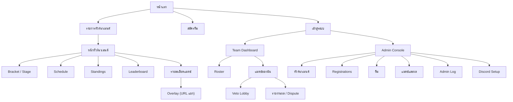
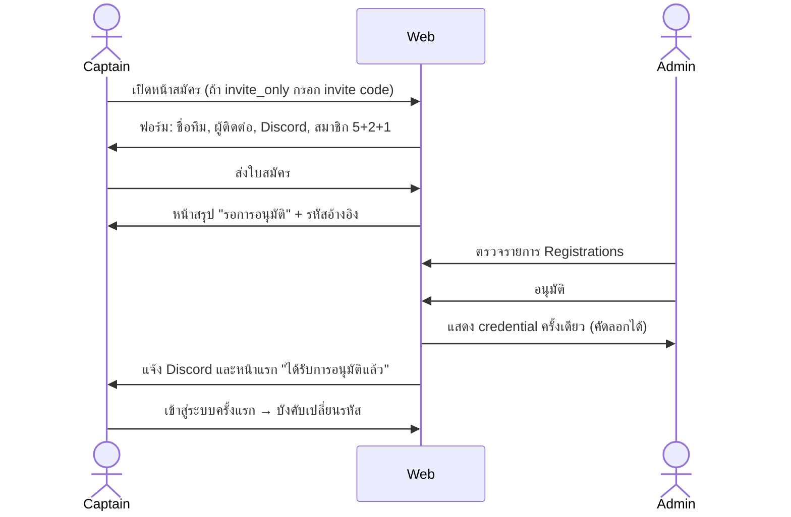
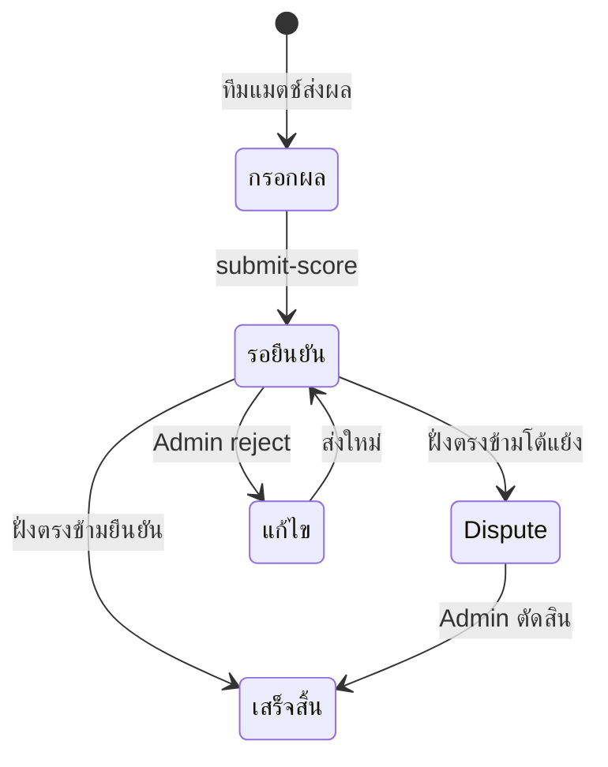

# VALORANT Tournament Platform: UX/UI Design Spec v1.0

Repository: `NOOMFUU/valorant-tournament`
อ้างอิง: `design/valorant-tournament-system-design.md` (v2) และ `design/valorant-tournament-system-design-appendix-v2.1.md`
สถานะ: Draft สำหรับ review

> เอกสารนี้ออกแบบ UX/UI จาก system design และ API ที่ระบุในเอกสารเดิม ยังไม่ได้อ่านไฟล์ใน `public/` ดังนั้นการตั้งชื่อหน้าและ component ต้องตรวจกับ HTML จริงก่อนลงมือทำ

---

## 1. ขอบเขต

### 1.1 In scope
- หน้าสาธารณะ: หน้าแรก, รายการทัวร์นาเมนต์, หน้าทัวร์นาเมนต์ (bracket, standings, schedule, leaderboard)
- หน้าสมัครทีม และ flow การอนุมัติ
- Team dashboard: roster, check-in, veto, รายงานผล, dispute, forfeit, reschedule
- Veto lobby (real-time)
- Admin console: จัดการทัวร์นาเมนต์, stage, match, ผล, ทีม, admin log
- Overlay สำหรับ caster / stream
- Design system: tokens, component, state, responsive, accessibility

### 1.2 Out of scope (รอบนี้)
- Payment, ranking ข้ามฤดูกาล (ตาม non-goals ใน v2)
- Discord UI (ใช้ Discord เป็นช่องทางแจ้งเตือนและ role เท่านั้น)
- Mobile app native

---

## 2. ผู้ใช้และเป้าหมาย

| Persona | บริบท | เป้าหมายหลัก | ความกังวล |
|---|---|---|---|
| Visitor | ผู้ชม มาดูตารางแข่ง | หาแมตช์ถัดไปและผลล่าสุดได้ภายใน 10 วินาที | ข้อมูลไม่ตรงกัน |
| Applicant (Captain) | หัวหน้าทีมที่จะสมัคร | สมัครได้ครบในครั้งเดียว รู้สถานะการอนุมัติ | กลัวข้อมูลผิดแล้วถูกปฏิเสธ |
| Team member | สมาชิกทีมที่เข้าแมตช์ | check-in, veto, รายงานผลได้ไม่พลาด | เวลาเหลือน้อย, ไม่รู้ว่าต้องทำอะไร |
| Admin | ผู้จัดงาน | ตั้งค่าทัวร์นาเมนต์, ตัดสิน dispute, ตรวจ audit | งานซ้อนกันหลายแมตช์พร้อมกัน |
| Caster / Streamer | ถ่ายทอดสด | ดู score และ veto บนหน้าจอ OBS | ข้อมูลเกินและเปลี่ยนเร็ว |

---

## 3. หลักการออกแบบ

1. **Status first**: ทุกหน้าต้องบอกสถานะปัจจุบันและ "ขั้นต่อไปที่ต้องทำ" ก่อนรายละเอียด
2. **Time is visible**: เวลาแมตช์, เวลาถอยหลัง check-in, เวลา veto ต้องเด่นและอัปเดตแบบ real-time
3. **ข้อมูลตามสิทธิ์**: หน้าสาธารณะไม่แสดง veto state, score submission, หรือข้อมูลส่วนตัว (ตาม serializer ใน v2 ข้อ 12-13)
4. **Confirm ก่อนผลกระทบสูง**: reset, force-winner, ลบทีม, ลบ stage ต้องมี confirm พร้อมสรุปผลกระทบ
5. **ไม่พึ่ง Discord เป็นหลัก**: ทุก action สำคัญทำได้บนเว็บ Discord เป็นแค่การแจ้งเตือน
6. **ภาษา**: ไทยเป็นภาษาหลัก, ศัพท์เกม (Veto, Ban, Pick, Side, Map) คงภาษาอังกฤษ

---

## 4. Information Architecture

**Navigation**
- Public nav: หน้าแรก, ทัวร์นาเมนต์, สมัครทีม, เข้าสู่ระบบ
- Team nav (หลัง login): แมตช์ของฉัน, Roster, ผลงาน, ออกจากระบบ
- Admin nav: ทัวร์นาเมนต์, Registrations, ทีม, แมตช์, Log
- ไม่มี nav ย่อยที่เข้าได้ทั้งที่ไม่มีสิทธิ์ ให้ซ่อนแล้ว redirect ไปหน้า login

---

## 5. User Flows

### 5.1 สมัครทีม (Applicant → Admin)

**ข้อกำหนด**
- ฟอร์มแบ่งเป็น 3 ขั้น: ข้อมูลทีม, สมาชิก (Riot ID ทุกคน), ตรวจสอบและยืนยัน
- Validation แบบ inline ทันทีที่ blur ไม่ใช่รอตอนกดส่ง
- Riot ID ใช้รูปแบบ `ชื่อ#แท็ก` และมีปุ่ม "ตรวจสอบ" ที่เรียก Riot API (แสดง ✓ หรือข้อความผิดพลาด)
- ป้องกันการส่งซ้ำด้วยปุ่ม disable ระหว่างส่ง และ idempotency key
- Rate limit: แสดงข้อความ "ลองใหม่ในอีก X นาที" ไม่ใช่ error ทั่วไป

### 5.2 Check-in (Team member)
- ปุ่ม check-in ปรากฏตั้งแต่ `CHECKIN_OPEN_BEFORE_MIN` ก่อนเวลาแข่ง (ค่าเดียวจาก server ตามคำถามข้อ 1 ใน v2)
- หลังกดแล้วเปลี่ยนเป็นสถานะ "เช็คอินแล้ว" พร้อมเวลา
- หมดเวลา: แสดงป้าย "ปิดรับเช็คอิน" และอธิบายผลที่จะตามมา

### 5.3 Veto (Veto Lobby)
- ทั้งสองทีมเข้า room เดียวกันผ่าน Socket.IO ตรวจ membership ก่อน join
- Layout: แถบ timer ด้านบน, แผนที่เป็นการ์ดขนาดใหญ่, ลำดับ action (ban/pick/side) ด้านข้าง
- Turn indicator ชัดเจน: ทีมไหนกำลังทำ action และเหลือเวลากี่วินาที
- Timer ถึง 10 วินาทีสุดท้ายให้เปลี่ยนสี และแจ้งเสียงให้เลือกได้ (default ปิด)
- ปุ่ม "ขอพัก" แสดงจำนวนครั้งที่เหลือ
- ผู้ชม (ไม่ใช่ทีม) เห็นได้เฉพาะ state สาธารณะ

### 5.4 รายงานผลและ Dispute

**ข้อกำหนด**
- ฟอร์มผลแบบเลือกแผนที่ทีละแมป (ไม่ใช่กรอกตัวเลขอิสระ) เพื่อลดข้อผิดพลาด
- ระบบแจ้งเตือนถ้าผลไม่ตรงกับ format (BO1/BO3/BO5) ก่อนส่ง
- ทีมที่ส่งผลเห็นสถานะ "รอฝั่งตรงข้ามยืนยัน" ไม่เห็นปุ่มยืนยัน
- ทีมฝั่งตรงข้ามเห็นปุ่ม "ยืนยัน" และ "โต้แย้ง" พร้อมช่องเหตุผล

### 5.5 Forfeit
- ปุ่ม "แจ้งทีมไม่มา" ปรากฏหลังเวลาแข่งผ่านไป 15 นาที (ตาม state diagram v2 ข้อ 5)
- ต้องแนบหลักฐาน (screenshot) ก่อนส่ง
- แสดงป้าย "Forfeit" ผ่าน flag ไม่ต่อท้ายชื่อแมตช์

---

## 6. หน้าจอ (Screen Specs)

### 6.1 หน้าแรก (Public)
- Hero: ชื่อทัวร์นาเมนต์ที่กำลังแข่ง + ปุ่ม "ดูตาราง" และ "สมัครทีม"
- การ์ดแมตช์ถัดไป (3-5 แมตช์) และแมตช์ที่กำลัง live พร้อมป้ายสีแดง LIVE
- ผลล่าสุด 5 แมตช์
- ลิงก์ไปทัวร์นาเมนต์ที่เปิดรับสมัคร

### 6.2 หน้าทัวร์นาเมนต์
- Header: ชื่อ, สถานะ (เปิดรับสมัคร / กำลังแข่ง / จบแล้ว), วันที่, prize pool
- Tabs: Bracket, Schedule, Standings, Leaderboard, Rules
- Bracket: แสดง stage แบบ tab ย่อย, เลื่อนแนวนอนบนมือถือ, ไฮไลต์ทีมที่เลือก
- Schedule: จัดกลุ่มตามวัน, กรองตาม stage และสถานะ
- Standings: คอลัมน์ W-L, map diff, round diff, tie-break แสดงคำอธิบายข้าง table (ตามข้อ 7 ใน v2)
- Leaderboard: ACS, K/D, ADR, ตารางเรียงได้, top 50 (ตาม statsRoutes)

### 6.3 รายละเอียดแมตช์ (Public)
- ทีม A vs ทีม B พร้อมโลโก้, สถานะ, เวลา
- ผลแต่ละแมป (ถ้ามี) และสถิติผู้เล่น
- ไม่แสดง veto state หรือ score submission ขณะที่แมตช์ยังไม่จบ

### 6.4 สมัครทีม
ดูข้อ 5.1 ฟิลด์:
- ชื่อทีม (required, unique), ชื่อย่อ, โลโก้ (PNG/JPG/WebP, ไม่เกิน 2 MB, preview ก่อนส่ง)
- ผู้ติดต่อ: ชื่อ, Discord
- สมาชิก 5 Main + 2 Sub + 1 Coach: ชื่อ, Riot ID, role
- Invite code (ถ้า invite_only)

### 6.5 Team Dashboard
- Header: โลโก้ทีม, สถานะ approved, ปุ่มออกจากระบบ
- Card "แมตช์ถัดไป" ใหญ่ที่สุดในหน้า: เวลา, คู่แข่ง, countdown, ปุ่ม check-in/veto/รายงานผลตามสถานะ
- Card "แจ้งเตือน" (notification) แสดงเฉพาะของทีมตัวเอง (แก้ตาม N3-N4 ใน appendix)
- Roster: ตาราง สมาชิก, role, สถานะ, ปุ่มขอแก้ Riot ID (แสดง "รออนุมัติ" ถ้ามี pendingUpdate)
- Roster ถูกล็อกหลังเริ่มทัวร์นาเมนต์: แสดง banner อธิบายเหตุผล

### 6.6 Admin Console
- Layout: sidebar ซ้าย, เนื้อหาขวา, header มี search และปุ่มแจ้งเตือนงานค้าง
- Dashboard หลัก: "งานที่ต้องทำ" (dispute รอตัดสิน, registration รออนุมัติ, แมตช์ forfeit claim, check-in หมดเวลา) ในหน้าเดียว
- ตารางแมตช์: กรองตาม stage, สถานะ, วัน; แต่ละแถวมี action ตามสถานะ
- Action อันตราย (reset match, force-winner, delete team/stage) ใช้ modal confirm พร้อมแสดงผลกระทบ (จำนวน match ที่ propagate, wins/losses ที่จะย้อน)
- Admin Log: ตาราง filter ตาม actor, action, matchId, teamId, วันที่; pagination (แทนที่ 100 รายการคงที่)
- Bracket editor: drag-drop ทีมใน stage ได้เฉพาะ stage ที่ยังไม่เริ่ม, stage ที่เริ่มแล้วล็อกและแสดงเหตุผล

### 6.7 Overlay (Caster / OBS)
- URL แยกต่อแมตช์, พื้นหลังโปร่งใส, ขนาด 1920x1080 และ 1280x720
- แสดง: ชื่อทีม, โลโก้, series score, map ปัจจุบัน, veto ที่ทำไปแล้ว
- ไม่มี interaction ใด ๆ, ไม่แสดงข้อมูลที่เป็นความลับ (vetoData ทั้งหมดรวม ready flags ควรตัดออก ตามข้อ B.5)
- Animation การเปลี่ยน score แบบ fade 300 ms

---

## 7. Design System

### 7.1 Tone
สไตล์ตามแนว "competitive esports" แต่อ่านง่าย ไม่ใช้ตัวอักษรแปลกจนอ่านยาก

### 7.2 Color tokens
| Token | ค่า (ตัวอย่าง) | การใช้ |
|---|---|---|
| `--color-bg` | `#0F1419` | พื้นหลังหลัก |
| `--color-surface` | `#1A212B` | card, panel |
| `--color-border` | `#2C3644` | เส้นขอบ |
| `--color-text` | `#ECEFF4` | ข้อความหลัก |
| `--color-text-muted` | `#8A94A6` | ข้อความรอง |
| `--color-primary` | `#FF4655` | ปุ่มหลัก, LIVE, action สำคัญ |
| `--color-success` | `#2ECC71` | approved, verified, เช็คอินแล้ว |
| `--color-warning` | `#F5B841` | ใกล้หมดเวลา, pending |
| `--color-info` | `#4DA3FF` | ลิงก์, ข้อมูลทั่วไป |

ค่าสีต้องผ่าน WCAG AA (contrast อย่างน้อย 4.5:1 สำหรับข้อความปกติ) ทุกคู่ที่ใช้งานจริง

### 7.3 Typography
- ฟอนต์หลัก: Noto Sans Thai (ภาษาไทย) + Inter (ตัวเลขและอังกฤษ)
- ขนาด: 12 / 14 / 16 / 20 / 24 / 32 / 48 px
- ตัวเลข timer และ score ใช้ `font-variant-numeric: tabular-nums` เพื่อไม่ให้กระพริบ
- ความสูงบรรทัดภาษาไทยอย่างน้อย 1.6 เพราะวรรณยุกต์และสระบน

### 7.4 Spacing และ layout
- Grid 8 px, container สูงสุด 1280 px
- Breakpoint: 360 / 768 / 1024 / 1280 px

### 7.5 Components
| Component | หมายเหตุ |
|---|---|
| Button | primary, secondary, danger, ghost; มี loading และ disabled |
| Status badge | scheduled, live, pending, finished, bye, forfeit, disputed |
| Match card | ทีม A/B, โลโก้, score, เวลา, action ตามสถานะ |
| Bracket node | เลือกได้, highlight ทีมที่เลือก |
| Countdown | ใช้กับ check-in และ veto; เปลี่ยนสีเมื่อเหลือ 10 วินาที |
| Table | เรียงได้, sticky header, เลื่อนแนวนอนบนมือถือ |
| Modal confirm | ระบุผลกระทบ, ปุ่มยกเลิกอยู่ซ้าย ปุ่มยืนยันอยู่ขวา |
| Toast | แจ้งผลสำเร็จ/ผิดพลาด, หาย 5 วินาที, error ไม่หายจนกว่าผู้ใช้ปิด |
| Empty state | บอกว่าทำไมว่าง และมี action ถัดไป |
| Form field | label ด้านบนเสมอ, error ใต้ field, ไม่ใช้ placeholder แทน label |

---

## 8. States และ Error Handling

ทุกหน้าต้องมีครบ 4 สถานะ: loading (skeleton), empty, error (พร้อมปุ่ม retry), และ success

| สถานการณ์ | ข้อความผู้ใช้ | พฤติกรรม |
|---|---|---|
| Socket หลุด | "การเชื่อมต่อขาดหาย กำลังเชื่อมใหม่..." | reconnect อัตโนมัติ, แสดงสถานะ |
| Discord ไม่พร้อม | "การแจ้งเตือน Discord ล่าช้า ผลถูกบันทึกแล้ว" | ไม่บล็อก action บนเว็บ (ตาม graceful degradation ข้อ 11 v2) |
| Session หมดอายุ | "กรุณาเข้าสู่ระบบอีกครั้ง" | เก็บ draft ฟอร์มไว้ถ้าเป็นไปได้ |
| Score ไม่ตรง format | "BO3 ต้องมีผู้ชนะ 2 แมป" | ป้องกันการส่งก่อน submit |
| ผลถูกแก้โดย admin ระหว่างดู | "ผลแมตช์มีการเปลี่ยนแปลง กรุณารีเฟรช" | ใช้ resultVersion (v2 ข้อ 4.5) |
| ไม่มีสิทธิ์ | "คุณไม่ได้อยู่ในแมตช์นี้" | ไม่แสดงข้อมูลแมตช์ |

---

## 9. Accessibility

- คอนทราสต์ตาม WCAG AA ทุกข้อความและปุ่ม
- สถานะต้องไม่ใช้สีอย่างเดียว (ใช้ไอคอนและข้อความประกอบ)
- ปุ่มและ control ทั้งหมดใช้คีย์บอร์ดได้ มี focus ring ที่เห็นชัด
- Timer และการแจ้งเตือนสำคัญใช้ `aria-live` (polite; urgent สำหรับ 10 วินาทีสุดท้าย)
- ขนาดปุ่มสัมผัสอย่างน้อย 44x44 px
- รองรับ `prefers-reduced-motion` ปิด animation ที่ไม่จำเป็น
- ภาพโลโก้ทีมมี alt text เป็นชื่อทีม

---

## 10. Responsive

- **Mobile (360-767)**: หน้า Team dashboard และ Veto lobby เป็นหลัก ใช้ bottom action bar, bracket เลื่อนแนวนอน
- **Tablet (768-1023)**: sidebar ย่อเป็น icon
- **Desktop (1024+)**: Admin console เต็มรูปแบบ, bracket เต็ม
- Overlay ไม่ responsive ใช้ขนาดตายตัวตามข้อ 6.7

---

## 11. Mapping กับ API และ Socket (สรุป)

| หน้า | API / Event | หมายเหตุ |
|---|---|---|
| หน้าแรก, ทัวร์นาเมนต์ | `GET /tournaments/:id/public`, `GET /matches/upcoming` | ต้องแก้ populate ก่อน (v2 ข้อ 7) |
| Bracket | `GET /stages/:stageId/...` | เปลี่ยนจาก index เป็น `stageId` (Phase 2) |
| Standings | `/stages/:stageId/standings` | ต้องมี seed tie-break |
| สมัครทีม | `POST /tournaments/:id/register` | เขียนลง `Registration` (Phase 2) |
| Team dashboard | `GET /teams/me` | ต้องลบ `password` ออกก่อน (N1) |
| Notification | `GET /notifications` | ต้องมี `teamId` ใน JWT (N3) |
| Veto | Socket `join_match`, `match_update` | ตรวจ membership และ payload ตาม role (v2 ข้อ 10, 12) |
| รายงานผล | `submit-score`, `verify-score`, `dispute-score` | ผ่าน ResultService (Phase 3) |
| Overlay | `GET /overlay/match/:id` | ตัด `vetoData` ที่ไม่จำเป็น |
| Admin log | `GET /admin/logs` | ต้องเพิ่ม pagination และ filter |

**ข้อกำหนดร่วม**: หน้า UI ทุกหน้าต้องรองรับ error contract แบบเดียวกัน `{ success, msg }` (v2 ข้อ 14) ไม่งั้น UI ต้องเดา format

---

## 12. ลำดับการทำงาน (ให้สอดคล้องกับ roadmap)

| Step | งาน UI | ขึ้นกับ phase |
|---|---|---|
| 1 | Design tokens และ component พื้นฐาน | ไม่มี |
| 2 | หน้า public (หน้าแรก, ทัวร์นาเมนต์, schedule, standings) | Phase 2 (stage routes) |
| 3 | หน้าสมัครทีม และ Admin registrations | Phase 2 (`Registration`) |
| 4 | Team dashboard และ roster | Phase 1 (ลบ password, roomPassword) |
| 5 | Veto lobby | Phase 1b, 1c, Phase 5 |
| 6 | รายงานผล, dispute, forfeit | Phase 3 (ResultService) |
| 7 | Admin console ครบ และ Admin log | Phase 2-4 |
| 8 | Overlay | Phase 5 (payload ตาม role) |

---

## 13. คำถามที่ต้องตัดสินใจก่อนทำ UI

1. Brand: ใช้สีและโลโก้ของทัวร์นาเมนต์เอง หรือยึด tone ของ VALORANT
2. ภาษา: ไทยอย่างเดียว หรือมีอังกฤษคู่กัน
3. Dark mode อย่างเดียว หรือรองรับ light mode ด้วย
4. Veto lobby: เสียงแจ้งเตือนเปิด/ปิด default
5. Admin console ใช้ได้บนมือถือหรือไม่ (ถ้าไม่ จะลดขอบเขต responsive)
6. Overlay: ต้องการ theme หลายแบบต่อทัวร์นาเมนต์หรือไม่

---

## 14. Definition of Done (UX/UI)

- [ ] Design tokens และ component ใช้ซ้ำได้ทุกหน้า
- [ ] ทุกหน้ามี loading, empty, error, success
- [ ] Flow สมัคร, check-in, veto, รายงานผล, dispute, forfeit ทดสอบได้ end-to-end
- [ ] ผ่าน WCAG AA ตรวจด้วยเครื่องมือและทดสอบคีย์บอร์ด
- [ ] ทดสอบ 360, 768, 1280 px
- [ ] หน้า public ไม่แสดงข้อมูลที่ถูกตัดตาม serializer
- [ ] Action อันตรายทุกตัวมี confirm พร้อมผลกระทบ
